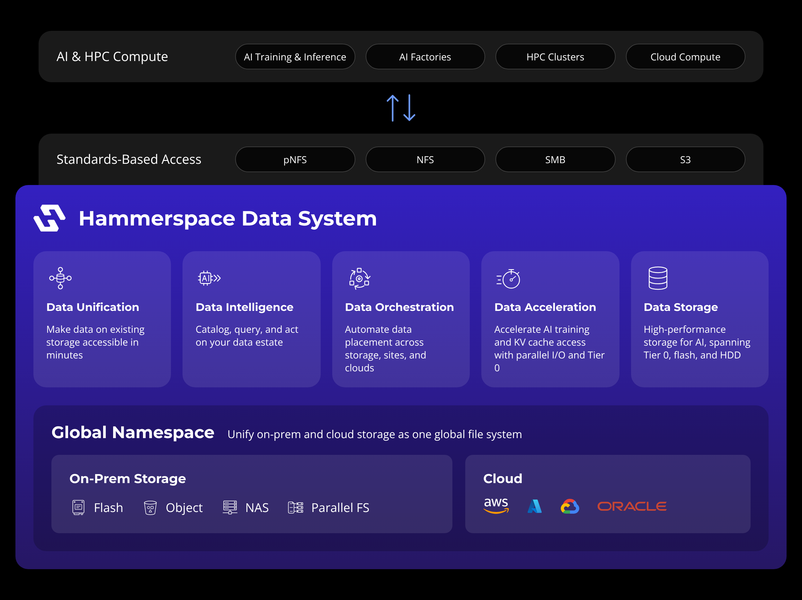

<!--
  Hammerspace GitHub landing page.
  For an organization profile, place this file at profile/README.md in the org's public `.github` repository.
-->

# Build with Hammerspace

Find the tools and resources you need to get started with Hammerspace. Explore open-source projects, deployment examples, infrastructure as code, SDKs, APIs, and integrations to automate deployments and build data-driven applications.

Hammerspace provides a standards-based parallel file system and global namespace for accessing and orchestrating distributed data across storage environments.

## 🏗️ Hammerspace Architecture

  

---

## 🚀 Get Started

### 🧪 Use Cases and Code Labs

- **[Tier 0 Deployment](https://github.com/hammerspace-solutions/Ansible-Tier0)**: Ansible automation that turns local NVMe on GPU servers into shared Tier 0 storage: RAID, XFS, NFS, tuning and Anvil registration across AWS, Azure, GCP, OCI and on-prem
- **[AWS Deployment Blueprint](https://github.com/hammerspace-solutions/Terraform-AWS)**: Terraform plus Ansible to stand up Hammerspace, clients, storage servers and EC Groups on AWS
- **[OCI Deployment Blueprint](https://github.com/hammerspace-solutions/Terraform-OCI)**: Terraform for deploying Hammerspace on Oracle Cloud Infrastructure
- **[Cloud Performance Testing](https://github.com/hammerspace-solutions/Cloud-Performance-Testing)**: Scripts to benchmark cloud performance for Hammerspace deployments
- **[Code Snippets](https://github.com/hammer-space/sample_scripts)**: Collection of example scripts to build on Hammerspace

### 🔌 Application Integrations

- **[ShotGrid Integration](https://github.com/hammer-space/sghs)**: Connects Autodesk ShotGrid production tracking to Hammerspace for media and entertainment pipelines
- **[ftrack Integration](https://github.com/hammer-space/hsft)**: Connects ftrack production management to Hammerspace
- **[Deassimilation](https://github.com/hammerspace-solutions/Deassimilation)**: Tooling to move data back out of the Hammerspace Global Namespace to its source storage

### 🛠️ SDKs and Tools

- **[Python SDK](https://github.com/hammerspace-solutions/HammerSDK)**: Python client for the Hammerspace REST API, with authentication, task polling and typed exceptions handled for you
- **[Hammerspace Toolkit (hstk)](https://github.com/hammer-space/hstk)**: CLI and Python toolkit for working with Hammerspace from the client side
- **[Kubernetes CSI Driver](https://github.com/hammer-space/csi-plugin)**: Container Storage Interface driver that integrates the Hammerspace global data environment with Kubernetes, including block and file volumes
- **[Ansible](https://github.com/hammer-space/ansible)**: Ansible playbooks to automate Hammerspace configuration
- **[Terraform Examples](https://github.com/hammer-space/terraform)**: Terraform automation examples for Hammerspace
- **[Terraform Module: Hammerspace on AWS](https://github.com/hammerspace-solutions/terraform-aws-hammerspace)**: Module to build Hammerspace Anvil and DSX nodes on AWS
- **[Terraform Module: EC Groups on AWS](https://github.com/hammerspace-solutions/terraform-aws-ecgroups)**: Module that manages an EC Group deployment on AWS
- **Terraform Modules: AWS Services**: Supporting modules for [Aurora DB](https://github.com/hammerspace-solutions/terraform-aws-aurora) and [Amazon MQ](https://github.com/hammerspace-solutions/terraform-aws-amazon-mq) used in AWS deployments
- **[Grafana Dashboards](https://github.com/hammer-space/hammerspace-grafana-dashboards)**: Dashboards for the Prometheus exporters built into Hammerspace
- **[ELK Stack](https://github.com/hammer-space/hs-docker-elk)**: Docker Compose template for running Elasticsearch, Logstash and Kibana alongside Hammerspace
- **[rclone Container](https://github.com/hammerspace-solutions/rclone-docker)**: Containerized rclone build for moving data into and out of Hammerspace
- **[Wireshark Dissector Generator](https://github.com/hammer-space/dissector_generator)**: Generates Wireshark dissectors from XDR protocol definitions for NFS and protocol debugging

### 📚 Developer Resources

- [Technical Documentation](https://docs.hammerspace.com/)
- [pNFS Resource Center](https://hammerspace.com/parallel-nfs/)
- [Linux Advancements](https://hammerspace.com/linux-advancements/)
- [AI Data Platform](https://hammerspace.com/aidp-overview/)
- [Tier 0 Storage](https://hammerspace.com/tier-0/)
- [Technical Briefs](https://hammerspace.com/category/technical-brief/)

---

## 🤝 Get Connected

[Support](https://hammerspace.com/support/) · [Blog](https://hammerspace.com/blog/) · [Contact Us](https://hammerspace.com/contact-us/)
